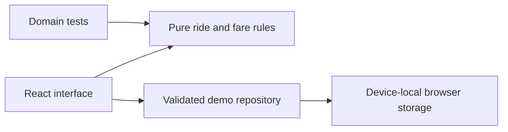
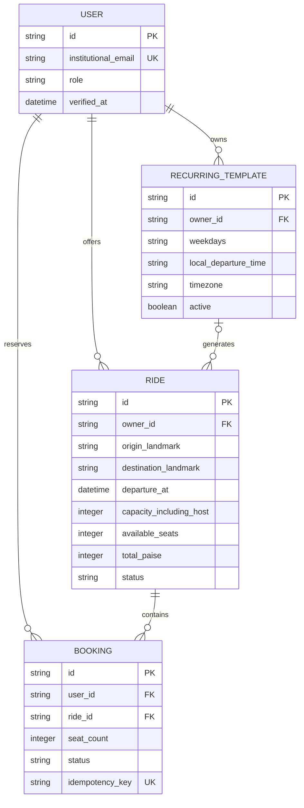

# ShareCommute architecture and requirements

## Phase 1 implemented structure

The repository validates saved records before using them. The pure rules have no browser dependencies and can be reused on the server. The Phase 1 browser is the single demo actor. Storage-event synchronisation improves local tab updates but does not provide multi-user transaction safety.

## Core acceptance requirements

| ID  | Requirement                                                                      | Phase |
| --- | -------------------------------------------------------------------------------- | ----- |
| R1  | Search matches named route, travel date, departure tolerance and requested seats | 1     |
| R2  | Reject past/closed rides, excess seats, duplicate bookings and self-bookings     | 1     |
| R3  | Cancellation releases reserved seats and records cancelled status                | 1     |
| R4  | Validate distinct landmarks, future departure, capacity and whole journey fare   | 1     |
| R5  | Monetary shares add exactly to total cost in paise                               | 1     |
| R6  | Show joined/offered journeys and persist the local demo through reload           | 1     |
| R7  | Clearly label sample data and work at desktop and mobile widths                  | 1     |
| R8  | Verify approved institutional email and enforce ownership on every write         | 2     |
| R9  | Shared database transactions prevent competing final-seat reservations           | 2     |
| R10 | Recurring templates generate each scheduled occurrence at most once              | 2     |

## Phase 2 proposed data model

This model is a design, not an implemented database migration.

Use unique constraints for active user/ride bookings and template/date occurrences; foreign keys for ownership and ride associations; and checks for capacity, nonnegative paise and valid seat counts. The actual migration must encode constraints supported by the selected database.

## Proposed server interface

| Operation                     | Behaviour                                                                 |
| ----------------------------- | ------------------------------------------------------------------------- |
| GET /api/rides                | Verified route/time search; no private contact fields                     |
| POST /api/rides               | Validate fields and derive owner from the server session                  |
| POST /api/rides/:id/bookings  | Validate requested seats, reserve atomically and support idempotent retry |
| POST /api/bookings/:id/cancel | Check booking ownership and release seats atomically                      |
| POST /api/rides/:id/cancel    | Check host ownership and cancel affected bookings together                |
| GET /api/me/rides             | Return the signed-in user's joined and offered rides                      |

The server recomputes availability and cost using trusted records. A client-submitted price, user ID or available-seat number must never authorise a write. Verification, session expiry, CSRF protections where relevant and rate limiting belong to the server implementation.
